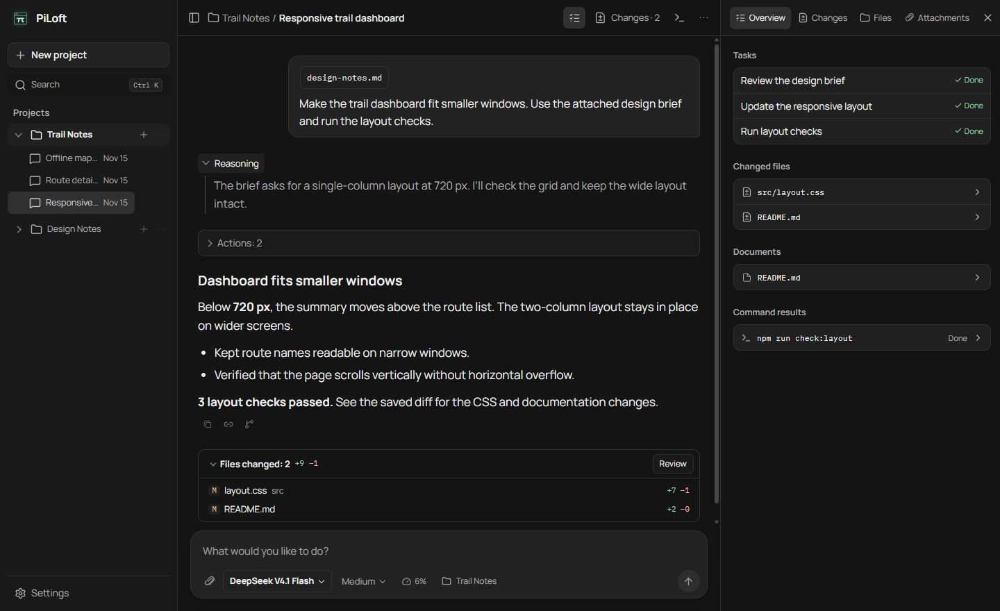
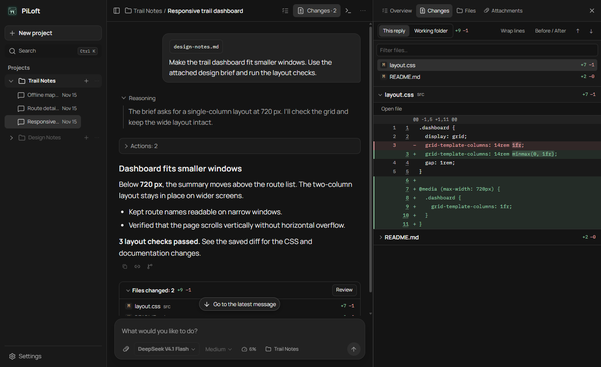
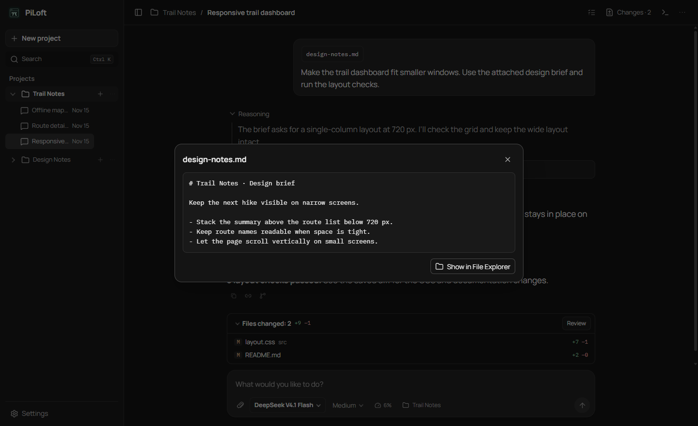
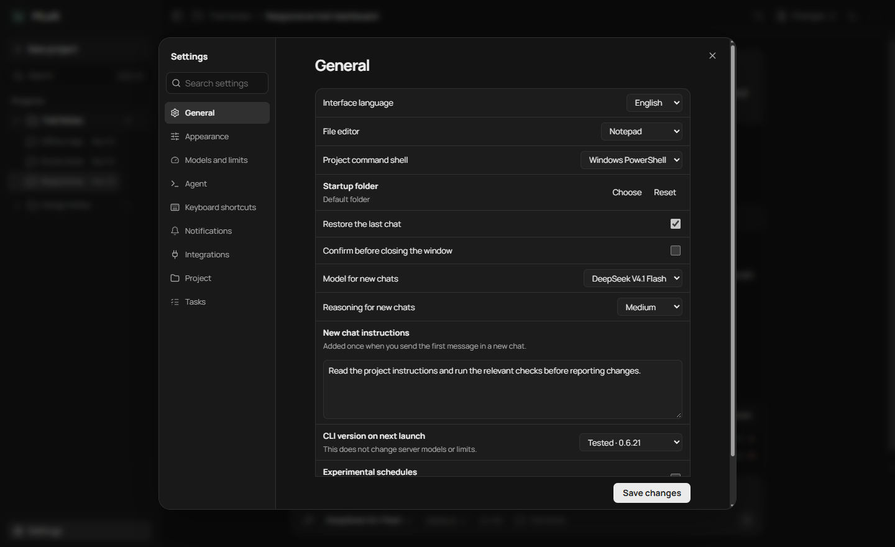

<div align="center">
  
  <h1>PiLoft</h1>
  <p>An unofficial Windows desktop app for the official <a href="https://github.com/dennisonbertram/free-pi-cli">free-pi CLI</a>. Chat, review changes, and manage projects in one window.</p>
  <p>
    
    
    <a href="LICENSE"></a>
  </p>
  <p><a href="https://github.com/b1nt1n/piloft/releases">Releases</a> · <a href="#install">Install</a> · <a href="#screenshots">Screenshots</a> · <a href="CHANGELOG.md">Changelog</a></p>
</div>



## What it does

| Chat and context | Projects and review |
| --- | --- |
| Stream Markdown and model reasoning, inspect the context reported by the CLI, and choose the model and reasoning level. | Switch between saved chats, check tasks and command results, and reopen a saved diff from the conversation. |
| Attach files, preview text and images, and show saved attachments in File Explorer. | Start a chat in a Git worktree, review changes line by line, and keep review-comment drafts across restarts. |

## Install

1. In this repository's **Releases**, download the PiLoft Windows x64 setup `.exe`. The installer is unsigned.
2. Choose English or Russian and a theme, then select a project folder.
3. Review the FreePi terms in the built-in terminal and connect your GitHub account.

Node.js and npm are bundled. The first run downloads the official CLI, and requests require an internet connection. Install Git to use text diffs. The default CLI version is **0.6.21**. Use **Settings → General** to switch to `latest` if FreePi requires an update.

Upgrading from the earlier Windows app named **free-pi-cli Desktop** uses the existing Desktop settings and free-pi sign-in and chat history.

## Screenshots

| Saved diff | Attachment preview |
| --- | --- |
|  |  |

<details>
<summary>General settings and new-chat instructions</summary>



</details>

## Build from source

The [desktop source](app/) requires Windows x64 and Node.js 22.15 or later. Run these commands from the repository root.

```powershell
Set-Location app
npm.cmd ci
npm.cmd start
```

From `app/`, run `npm.cmd run build:win` to build a Windows installer in `app/dist/`.

## FreePi service and data

The desktop app runs the official CLI in a terminal. FreePi manages GitHub sign-in, approvals, model availability, ads, and usage limits. Supported ads are shown in the chat view and the original CLI output remains available in the terminal.

FreePi may collect session content and use it for training or share it with third parties. Use the app only with content you are allowed to send to FreePi. [Terms of Service](https://freepi.ai/terms) · [Privacy Policy](https://freepi.ai/privacy)

The desktop app is [MIT licensed](LICENSE). [Third-party notices](THIRD-PARTY-NOTICES.md)
